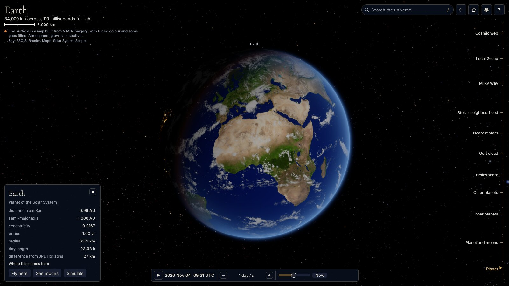
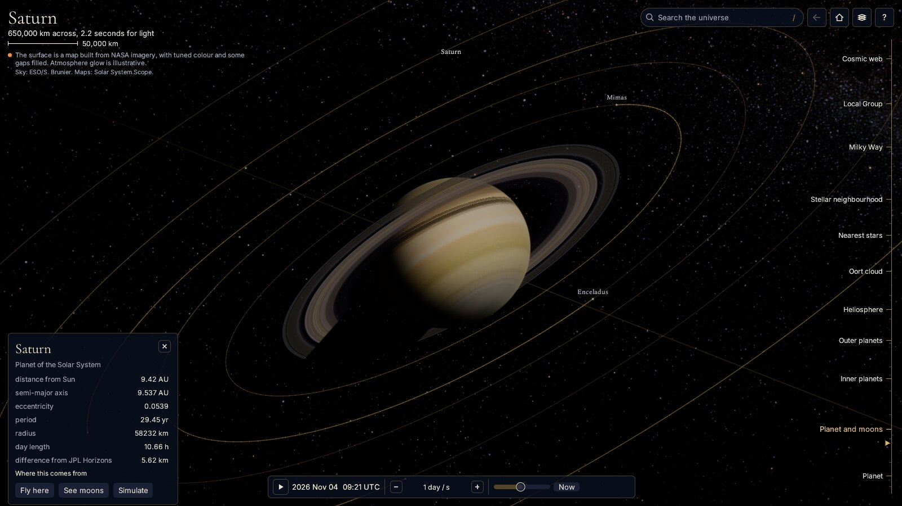
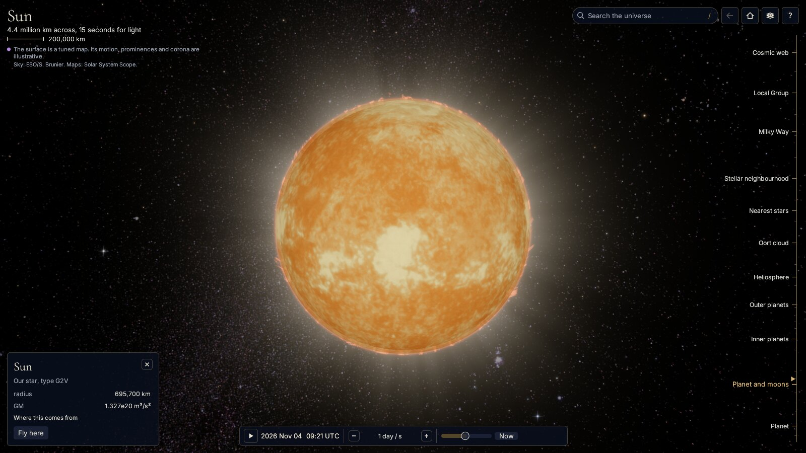
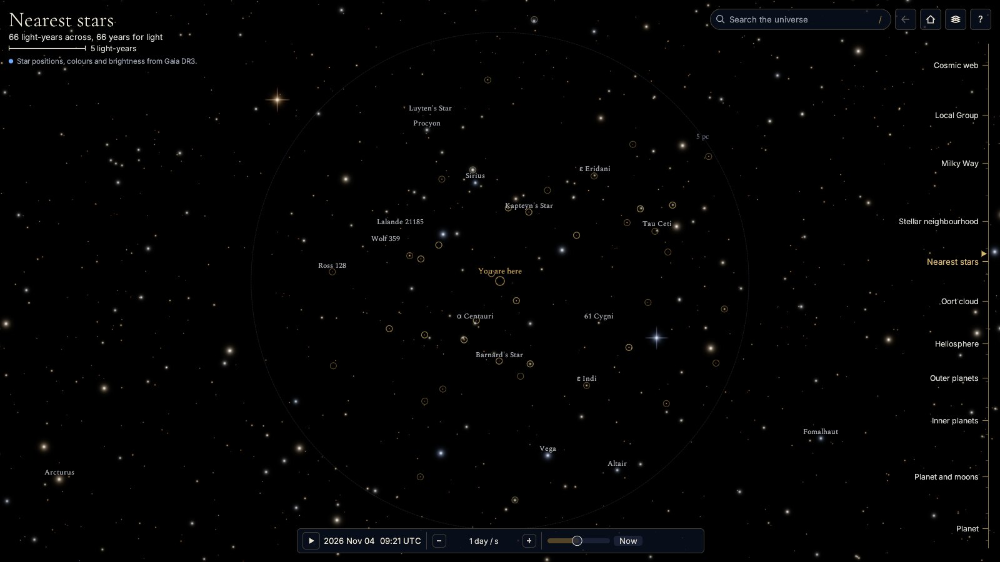
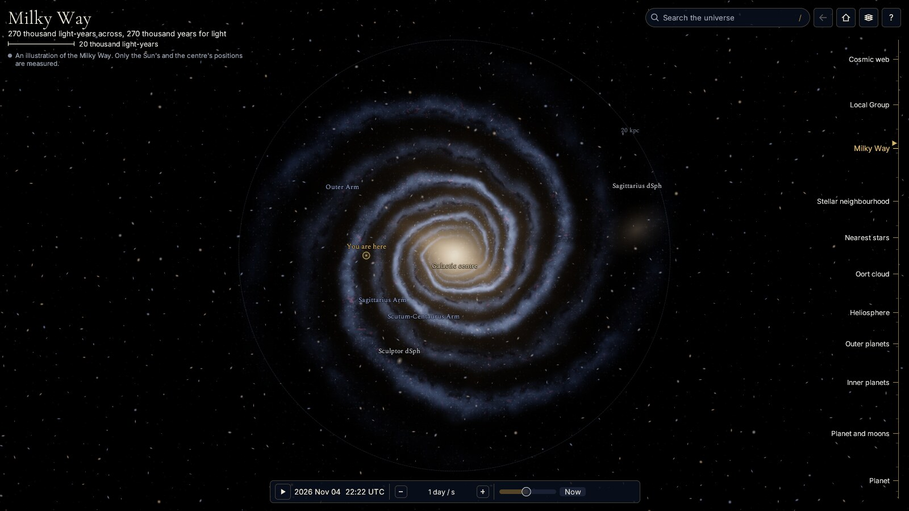
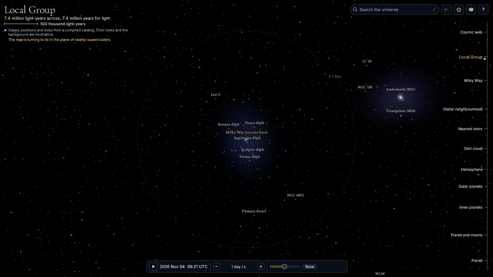
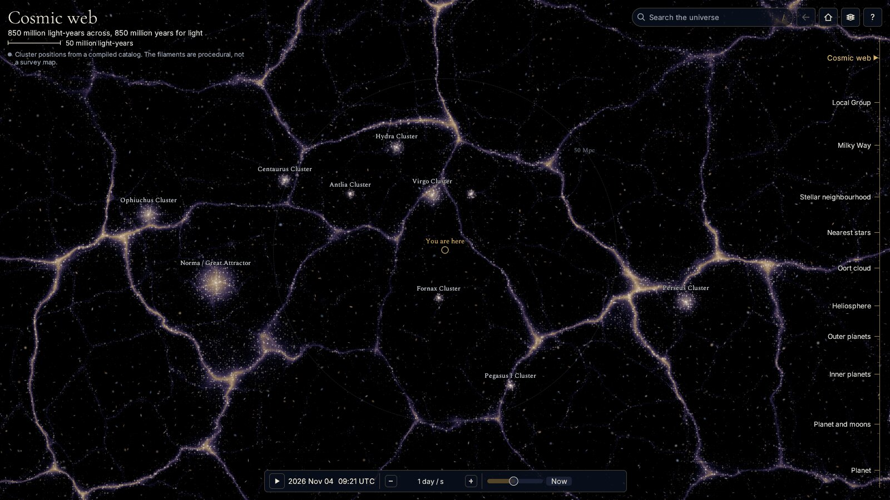

# Pantheon

An atlas of the universe as one continuous map. You start at Earth, where it is
right now, and zoom out without a single cut: past the Moon's orbit, the planets,
the edge of the solar wind, the nearest stars, the Milky Way, the Local Group, to
the cosmic web. That is about 19 orders of magnitude on one camera.

It's a native Rust application (eframe, egui, wgpu). It uses real data wherever
real data exists, and says so on screen when it doesn't.



| | |
|---|---|
|  |  |
|  |  |
|  |  |

## Run it on Linux

You need Rust ([rustup](https://rustup.rs) installs the pinned toolchain by
itself), a Vulkan driver, and these system packages:

```sh
# Fedora
sudo dnf install gcc pkgconf-pkg-config alsa-lib-devel libxkbcommon-devel wayland-devel libX11-devel

# Debian, Ubuntu
sudo apt install build-essential pkg-config libasound2-dev libxkbcommon-dev libwayland-dev libx11-dev
```

Then:

```sh
cargo build --release --bin pantheon --bin pantheon-cli
./target/release/pantheon
```

That already works on a fresh clone. The star, exoplanet and coastline catalogs
ship in the repository. Without the large downloads, planets have procedural
surfaces, positions come from approximate orbital elements, and spacecraft are
absent. The app tells you when that's the case, in its view menu.

To add the rest:

```sh
tools/fetch_data.py               # everything: about 3 GB, mostly JPL kernels
tools/fetch_data.py --no-kernels  # planet maps and spacecraft tracks: about 60 MB
tools/fetch_data.py --list        # see what's here and what isn't
```

Python 3.9 or newer and nothing else is required. `target/release/pantheon-cli --doctor`
checks the result. A dropped connection leaves no partial file behind, and running the script
again fetches whatever is missing or truncated. If a kernel on disk is damaged anyway, both
apps skip it, say so, and carry on with orbital elements.

To add Pantheon to your application menu, under `~/.local` only:

```sh
scripts/install-desktop.sh              # build, then add menu entries and icons
scripts/install-desktop.sh --uninstall  # take them away again
```

The installer won't overwrite a menu entry or icon it didn't write, and it refuses a checkout
path containing `$`, a backtick, `"`, `\` or `%`. Uninstalling removes Pantheon's entries and
icons and refreshes the menu and icon caches so they stop listing it. It leaves your settings:
the atlas keeps them in `~/.config/pantheon`, and you can delete that folder yourself.

No sound is built in if you'd rather skip ALSA: build with
`--no-default-features`. With sound compiled in, ambience stays off until you turn
it on.

## Moving around

| Input | What it does |
|---|---|
| Scroll, or pinch | Zoom at the pointer. Hold Shift for fine control |
| Drag | Move. A flick keeps drifting |
| Right-drag, or Shift-drag | Tilt and turn the view |
| Click | Select, and open the card. Names are clickable too |
| Double-click | Fly there. On empty space, zoom in |
| `/` or `Ctrl K` | Search for anything, then arrow keys and Enter |
| The scale on the right | Click a name to go there, drag to scrub through all of it |
| `H` | Fly home to Earth |
| `Backspace` | Back to the previous view |
| `+` `-`, arrows or `W A S D` | Zoom and move from the keyboard |
| `F` | Fly to the selection |
| `0` | Level the view |
| `Space` | Run or pause time |
| `[` `]` | Slower, faster |
| `N` | Back to now |
| `T` | Colour everything by evidence |
| `G` | Gravity field of the selected body |
| `Y` | Schematic spacing for exoplanet systems |
| `M` | Ambience |
| `Esc` | Close, or clear the selection |
| `?` | All of this, in the app |

The top left always says where you are, how wide the view is, how long light takes
to cross it, and what the picture is made of. When something you selected, or the
Sun, is off screen, an arrow at the edge points to it. Click the arrow to go there.

## What's real and what isn't

The project labels evidence, and the labels are on screen: the line under the
place name states what the current view is made of. Pressing `T` re-inks every
stroke by evidence class, and the legend lists only what's actually drawn. The
card's "Where this comes from" gives source, citation and frame for each value.

| You see | It is | Class |
|---|---|---|
| Planet and moon positions | JPL DE440s and satellite kernels, with Standish and mean elements outside coverage or without kernels. Our Moon's fallback is about 1° off on average from 1950 to 2050 (3.2° at worst), and worse outside that | measured / modeled |
| The moons of Uranus | Always mean elements, because no Uranian kernel is downloaded. Where each sits along its orbit is chosen for legibility | modeled / illustrative |
| Spacecraft paths | JPL Horizons vectors, Hermite-interpolated, never extrapolated | measured |
| Nearby stars and the naked-eye sky | ESA Gaia DR3: the 12,000 largest parallaxes among sources brighter than G 16 with parallax known to 10%, which reach about 35 pc and leave out fainter stars inside that, plus every source brighter than G 6 | measured |
| Exoplanet periods, sizes and hosts | NASA Exoplanet Archive | measured |
| Orientation of exoplanet orbits, their phases | A convention. Most systems have no known orientation | illustrative |
| Body orientation | IAU 2015 rotation elements, small terms omitted | modeled |
| Planet, Moon and Sun surfaces | Solar System Scope maps, based on NASA data. The publisher tunes the colour and fills unmapped gaps with fictional terrain | inferred |
| Clouds | One snapshot in the map set, not today's weather | inferred |
| Moons other than ours, and Pluto | Procedural: no map | procedural |
| Rings | Saturn's radial profile from a map, Uranus's from embedded zones. Shadows use the real sun direction | modeled |
| The sky behind the solar system | ESO's all-sky photograph, correct in direction, seen through a nominal lens because the atlas camera has no true field of view | measured |
| Atmosphere glow, the Sun's corona and motion | Shading choices, exaggerated to be visible | illustrative |
| Relief on rocky bodies | Derived from image brightness, not elevation | illustrative |
| Asteroid, Kuiper and Oort samples, the heliosphere's shape | Show where these are, not the rocks themselves. The Kirkwood gaps are in the right places | illustrative |
| The Milky Way | An illustration. Arms are stylized to pass near their real distances along the Sun's azimuth | procedural |
| Faint stars beyond the nearby sample, distant galaxies | Illustrative dust, kept out of the sphere where this atlas has the dense Gaia sample. A ring marks that sphere's edge, measured from the loaded catalog | procedural |
| Local Group and cluster positions | Compiled literature values, approximate sizes | measured |
| Their appearance, halos, the cosmic web's filaments | Procedural, not a survey map | illustrative |

Time is TDB internally and UTC on display. `KNOWN_ISSUES.md` lists what isn't done and
what to keep in mind.

## Graphics

An HDR canvas (16-bit float, 4x MSAA) with a real depth buffer, a mip-chain bloom,
and an AgX tonemap. It renders in physical pixels at any display scale. Orbit lines
are tessellated adaptively in 64-bit and clipped before they become 32-bit, so they
stay smooth at any zoom. Surface maps decode on worker threads and upload in slices
so nothing stalls a frame. Measured headless on an RTX 4060 at 2560x1440, a full frame costs about
1.5 to 5.5 ms depending on the scene. `pantheon --bench` measures your machine.

## Command line

```
pantheon                                 the interactive atlas
pantheon --list-shots                    preset scenes
pantheon --shot NAME[,NAME] [--size WxH] [--out DIR]    render without a window
pantheon --sweep [--size WxH] [--out DIR]   one frame per half decade, Earth to the web
pantheon --bench [--size WxH] [--scenes a,b]   frame cost on this GPU
pantheon --path FILE.json [--fps N] [--size WxH] [--out DIR]   render a recorded flight
pantheon --doctor                        GPU, kernels, datasets
pantheon-cli ...                         the same, always with console output
```

Record a flight from the view menu, save it, and render it with `--path`. Set
`PANTHEON_ASSETS` to use assets kept elsewhere: it names the folder that holds `data` and
`fonts`, the parent of what `tools/fetch_data.py --dest` takes. Set `PANTHEON_TEX_MAX` to cap
map resolution on a small GPU.

## Pantheon 3D

The same universe in true 3D, in a native Tauri window (WebKitGTK on Linux). The window
is `src-tauri/`, the renderer is `pantheon-web/` (three.js, vendored, no build step),
and the backend in `src/serve.rs` runs inside the same process on 127.0.0.1. No browser
is involved, and closing the window ends everything.

```sh
sudo dnf install webkit2gtk4.1-devel        # Debian, Ubuntu: libwebkit2gtk-4.1-dev
cd src-tauri && CARGO_TARGET_DIR=../target-3d cargo build --release
../target-3d/release/pantheon-3d
```

`scripts/install-desktop.sh` builds it too and adds its own menu entry. The window keeps
its small data (the first-run flag, WebKit's cache) beside the binary, in the checkout. Your
GPU driver's own shader caches under `~/.cache` are the driver's.

**Getting around.** Drag to swing around what you are looking at. Scroll to zoom: one
wheel goes from the ground to the cosmic web, and scrolling back returns you to where you
started. Click anything named to fly there. The ruler of places on the left is one-click
travel, `/` searches planets, moons, stars, exoplanet hosts, galaxies and clusters, and
Back and Home are always on screen. `F` or `W A S D` switches to free flight, where speed
follows the distance to the nearest thing; `L` adds mouse-look and Esc releases it. `P`
runs a grand tour, `Space` pauses time, `?` lists every key. Esc always backs out one step.

**What is real.** The line under the place name says what you are looking at, and every
row on a card has a label you can hover for its source. With the kernels downloaded, the
planets, the Moon and the moons of Mars, Jupiter, Saturn, Neptune and Pluto have kernel
positions. The moons of Uranus have no kernel here, so they sit on mean elements with an
illustrative place along each orbit, and their cards say so. The Sun, the planets, the Moon and
Earth's night lights are maps built from NASA data, with colours tuned and gaps filled by the
publisher, and the sky is a photograph; Pluto and the other moons have no maps and are
procedural, and marked so.
Modeled: atmospheres, ring lighting, eclipses (real geometry, modeled look). Illustrative,
and labeled so: the Milky Way and galaxy portraits, the filaments of the cosmic web, field
stars beyond the Gaia catalog, the Sun's corona, the surfaces of other stars, and how
exoplanets look. Cloud shapes are one saved snapshot, not today's weather. Earth's and Mars's
atmospheres are about 1.5x too tall so the limb reads, and fine detail close to a surface
is synthetic.

**Without the downloads.** A fresh clone has no `assets/data/textures` or SPICE kernels. It
still runs and says so on screen: planets become procedural, Earth is real outlines with
painted colors, the sky is the illustrative Galaxy model, and positions come from mean
elements, with our Moon on a simple model, about a degree off from 1950 to 2050 and worse
outside that. `tools/fetch_data.py` fetches the rest.

**Quality.** Automatic by default: it measures real frame cost and steps between four tiers,
and the Quality menu shows the numbers or fixes a tier. For a frame readout on screen, run
`PANTHEON_START_URL='/?fps' pantheon-3d`.

**The local server.** The window's backend listens on 127.0.0.1 and answers only its own page:
`Host` must be `127.0.0.1:<port>` or `localhost:<port>`, a request from any other origin
is refused, and it serves only the page's own files, not your disk or the kernels. The top of
`src/serve.rs` explains why. For test hooks and scripted access to the open window, set
`PANTHEON_QA=1` and open `'/?qa'`. While that's on, any program on this computer can run
scripts in the window, so it's for testing.

On NVIDIA's driver the app sets `WEBKIT_DMABUF_RENDERER_FORCE_SHM=1` before the webview
starts, because WebKitGTK's GPU-buffer path crashes on Wayland and leaves a blank window
under X11. If you set that or `WEBKIT_DISABLE_DMABUF_RENDERER` yourself, the app leaves it
alone. If your WebKitGTK is too old to have the setting and the window dies with "Error 71",
use `WEBKIT_DISABLE_DMABUF_RENDERER=1`.

## Layout of the code

Both renderers share these conventions: meters, time as a TDB Julian date, and one root
frame, heliocentric ecliptic J2000, with the Sun at the origin. A body's own frame has +Y at
the pole, +X at the prime meridian, and east toward -Z. The atlas has one orthographic camera,
with a 64-bit center and a meters-per-pixel scale, and sends the GPU screen-space primitives.
Pantheon 3D keeps the camera at the scene origin and re-parks every group relative to it each
frame, computed in JavaScript doubles, with a logarithmic depth buffer.

- `src/frames.rs`: coordinate frames, the camera, the zoom-and-pan flight path.
- `src/atlas.rs`: every scale band, composed into one frame.
- `src/engine/`: the wgpu renderer and the surface map bank. `shaders/` holds WGSL.
- `src/app.rs`, `src/app/`: state, input, the UI layout, search, settings.
- `src/sim.rs`: time, Kepler propagation, N-body islands, gravity mechanics.
- `src/spice.rs`: a dependency-free reader for NAIF kernels.
- `src/data.rs`, `src/evidence.rs`: datasets, and the record behind each evidence label.
- `pantheon-web/`: the 3D renderer. `src-tauri/`: its window. `src/serve.rs`: its backend.
- `tools/`: dataset and icon scripts. `scripts/`: the desktop installer.

`cargo test --lib --bins` runs the checks, including golden frame and time tests, a test
that panels never collide at any window size, and the local server's refusals over real
sockets. `tools/test_fetch_data.py` tests the downloader against a server that misbehaves on
purpose. All of it works with or without the large downloads: a test that needs them prints
`SKIPPED` and why, which CI's log will show, because the runner has none. CI has no GPU either,
so it renders on lavapipe, a software Vulkan driver, and sets `PANTHEON_REQUIRE_GPU=1` so that
a test that can't render fails rather than skips.

Pantheon is developed and tested on Linux. See the end of `KNOWN_ISSUES.md` about Windows.

## License

The source code is under the MIT license (see `LICENSE`). Datasets, imagery and
fonts keep their own terms, listed in `NOTICE`. Gaia data, which ships in this
repository, is CC BY-NC 3.0 IGO: non-commercial.
